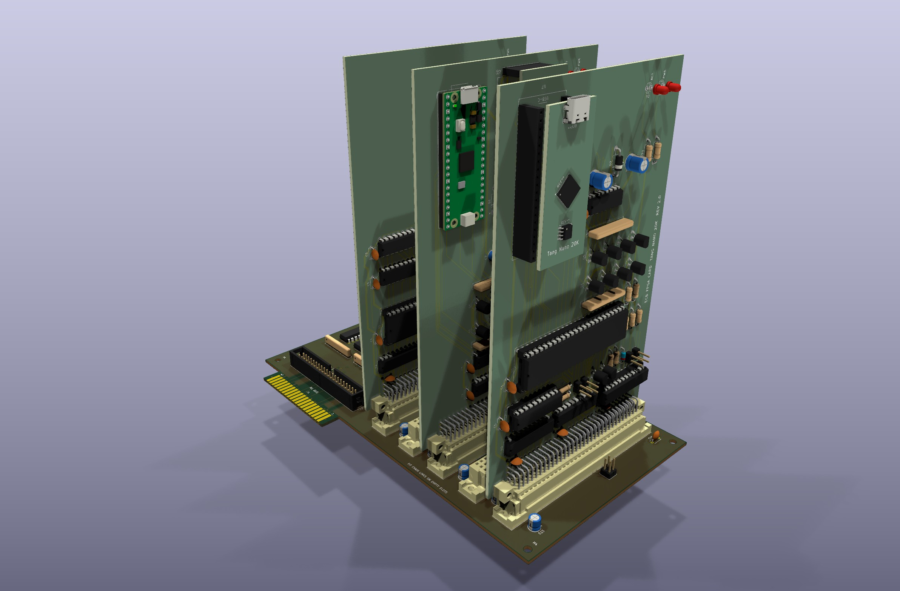

# TRS-80 Model I expansion system

All-through-hole hardware, FPGA design, firmware and Z80 software for the TRS-80 Model I.

- **Rev 2 (current):** three ECB Eurocard daughter cards, with two ways to connect them to the Model I. The design is in [docs/rev2-architecture.md](docs/rev2-architecture.md).
  - The custom **backplane**: 5 slots, 4 layers, with an Expansion Interface pass-through.
  - The **bridge card**: plugs into a standard ECB backplane. The Model I connects by ribbon to a right-angle header, and there's no EI.
- **Rev 0.1:** the original single card on a Tang Nano 9K. It remains here as a working reference; see [docs/hardware-design.md](docs/hardware-design.md).

*Rev 2 system on the custom backplane, raytraced from the KiCad designs by `hardware/tools/render_system.py`. The Tang Nano 20K and the SD breakout are simplified stand-in models.*

## Boards

All are routed, and DRC is clean against their schematics. None has been built yet.

| Board | Folder | What it does |
|---|---|---|
| **Bridge card** | `hardware/card-bridge/` | Option 2, instead of the backplane: Model I → ECB bridge on a 100 × 160 Eurocard for a standard ECB backplane (e.g. RetroBrew). The Model I bus arrives on a right-angle 2 × 20 header. Buffered A0–A15, hysteresis receivers on the strobes and a claim-decoded data buffer for a longer cable, and a GAL rebuilding MREQ*/IORQ*/RD*/WR*/M1*/RESET*. No Expansion Interface |
| **Backplane** | `hardware/backplane/` | Option 1: Model I → ECB bridge, 5 DIN 41612 C96 slots (RetroBrew ECB pinout), 4 layers. A GAL rebuilds MREQ*/IORQ*/RD*/WR*/M1* from the Model I strobes. It passes the bus through to the Expansion Interface; JP8/JP9 choose direct or GAL-gated EI RD*/WR* |
| **FPGA card** | `hardware/card-fpga/` | Tang Nano 20K + IDT7132 2 KB dual-port RAM at 3000h. A hardware sprite engine on ports 52h/53h draws into a 1 KB frame buffer the Z80 copies to the screen with LDIR, and an Am9511 maths coprocessor sits on ports 50h/51h |
| **SD card** | `hardware/card-sd/`, `firmware/sdcard/` | Raspberry Pi Pico running a FreHD-compatible hard disk on ports C0h–CFh: `.HDV` images, read-only DMK/JV3/JV1 floppy images, file transfer, and a DS1307 real-time clock |
| **Banked memory** | `hardware/card-xmem/` | 512 KB SRAM paged into 8000h–FFFFh, software-compatible with X-MEM/80 (OUT 41h/42h, 16 KB pages) and SuperMem (OUT 43h, 32 KB pages) |

**System map**
- **Memory:** 3000h–37DFh is the FPGA card's shared RAM; 8000h–FFFFh is banked RAM.
- **I/O:** 41h–43h banked memory, 50h–53h FPGA card, C0h–CFh SD card.
- **ECB line c10** is EXTMEM*. The banked-memory card drives it so the backplane can hide an Expansion Interface's own RAM. The bridge card, which has no EI, just pulls it up.

## Repository layout

| Path | Contents |
|---|---|
| `docs/rev2-architecture.md` | Rev 2 design: ECB pinout, bridge, each card as built, checks before ordering |
| `docs/bridge-card-timing.md` | How the bridge rebuilds the ECB signals the Model I bus lacks (MREQ*, IORQ*, M1*…), with timing diagrams |
| `docs/hardware-design.md` | Rev 0.1 card: memory and I/O maps, Tang Nano 9K pinout, BOM |
| `docs/sprite-engine.md`, `docs/am9511.md` | Sprite engine port protocol; Am9511 core programming model and accuracy |
| `hardware/gal/` | CUPL sources for all GALs: rev 0.1 decoders, `ecb_bridge` (backplane), `ecb_mem_decode`/`ecb_io_decode` (FPGA card), `ecb_sd_decode` (SD card), `ecb_xmem_io`/`ecb_xmem_mem` (banked memory). Compiled JEDEC files, verified by fuse-level simulation, are in `galasm/`; see [hardware/gal/README.md](hardware/gal/README.md) |
| `hardware/tools/` | Python generators that bootstrap each KiCad project: `gen_*.py` for schematics, `gen_*_pcb.py` for boards. Shared helpers are `kicadgen.py`, `pcbgen.py`, `ecb.py` and `parts.py`; `pcb_fixup.py` does post-route DRC clean-up. **Don't re-run a generator once its board is routed or edited in KiCad.** |
| `hardware/kicad/` | Rev 0.1 KiCad project (routed, DRC clean) |
| `fpga/` | Gowin Verilog: bus logic, sprite engine, Am9511 core. `build.tcl` builds for the Tang Nano 9K and `build20k.tcl` for the 20K; `sim/` holds the testbenches. See [fpga/README.md](fpga/README.md) |
| `firmware/sdcard/` | Pico firmware for the SD card (Pico SDK 2.3.1 + FatFs R0.15). Build with `build.ps1`; host tests are in `test/`. See [firmware/sdcard/README.md](firmware/sdcard/README.md) |
| `software/` | Z80 library, assembly demo (DEMO/CMD), Level II BASIC USR module and demo, emulator-based tests. See [software/README.md](software/README.md) |

## Status

| Part | Status |
|---|---|
| FPGA (20K) | 33% logic, Fmax 58 MHz; all simulation suites pass |
| SD firmware | Builds warning-free (64 KB); 79 host-side protocol checks pass |
| Z80 software | Tested in the project's Z80 emulator against the card models |

**Not done yet:**
- **Hardware:** nothing has been tried on real hardware. GAL JEDEC files are compiled and verified (`hardware/gal/galasm/`). Gerbers and drill files for all four boards are ready: see [hardware/ORDERING.md](hardware/ORDERING.md).
- **Checks before ordering:**
  - Tang Nano 20K row spacing and orientation.
  - The IDT7132 and AS6C4008 pinouts.
  - The SD module's pin order.
  - Whether the Model I accepts read data at 3000h.
  - Bus timing on the first boards.

  The full lists are in each section of [docs/rev2-architecture.md](docs/rev2-architecture.md).

## Licence

- **Software, FPGA HDL, firmware and tools:** MIT ([LICENSE](LICENSE)).
- **Hardware designs** (everything under `hardware/`: KiCad projects, GAL sources and JEDEC files, Gerbers): CERN Open Hardware Licence v2 – Permissive ([hardware/LICENSE](hardware/LICENSE)).
- **Third-party code:** `firmware/sdcard/lib/fatfs` is ChaN's FatFs under its own licence ([lib/fatfs/LICENSE.txt](firmware/sdcard/lib/fatfs/LICENSE.txt)).

## Credits

- The bus-interface ideas and card-edge geometry come from TRS-IO M1 v1.3-xray (Arno Puder).
- The Am9511 behavioural reference is ratboy666/am9511 (MIT).
- The ECB pinout follows the RetroBrew ECB backplane.
- The SD card and banked-memory card are independent implementations of the published FreHD (fvecoven/FreHDv1) and X-MEM/80 (lambdamikel/x-mem-80) interfaces. Both projects are GPL-3.0; no code or circuits were copied.
