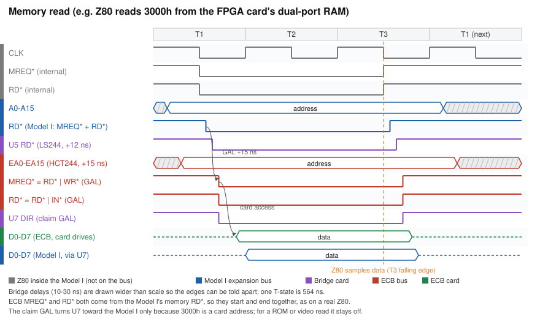
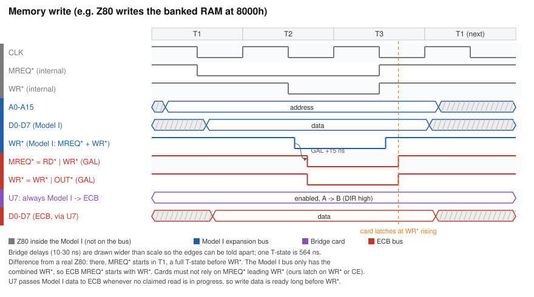
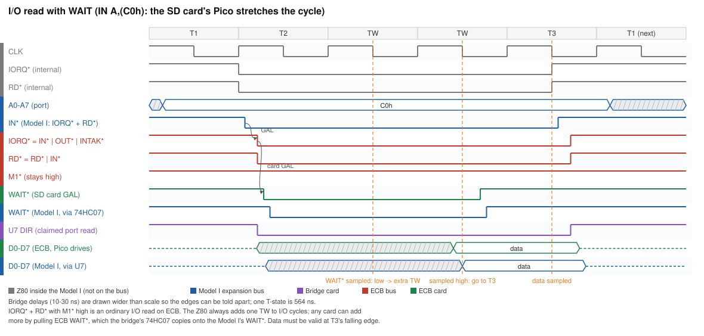
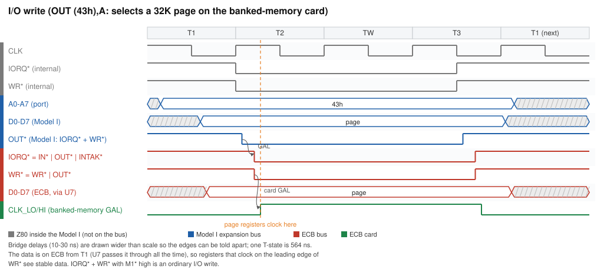
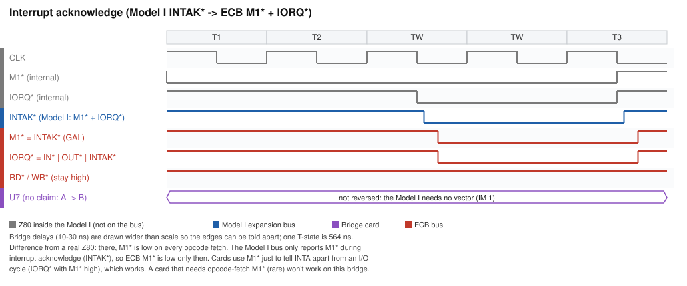
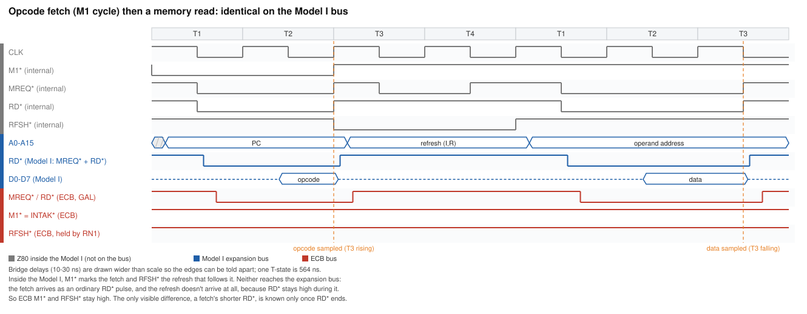
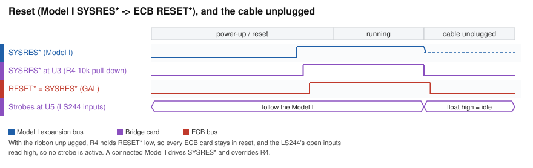

# Bridge card timing: rebuilding the ECB control bus from the Model I bus

This note explains how the bridge card (`hardware/card-bridge`, rev 3.1) creates the ECB signals that the TRS-80 Model I expansion bus does not carry. It also shows the bus cycles with timing diagrams. The custom backplane (`hardware/backplane`) uses the same logic in its own GAL (`ecb_bridge.pld`), plus the Expansion Interface gating. Apart from that gating and the bridge card's cable buffers, everything here applies to both.

The diagrams are generated by `hardware/tools/timing_diagrams.py`:

```bash
python hardware/tools/timing_diagrams.py
```

## 1. The problem

ECB cards expect the raw Z80 control bus. The Model I's expansion connector does not provide it. Inside the Model I, the Z80's MREQ*, IORQ*, RD*, WR* and M1* are combined into qualified strobes, and only those strobes reach the connector:

| Model I bus signal | Meaning (as decoded inside the Model I) |
|---|---|
| RD* | memory read: MREQ* and RD* both low |
| WR* | memory write: MREQ* and WR* both low |
| IN* | I/O read: IORQ* and RD* both low |
| OUT* | I/O write: IORQ* and WR* both low |
| INTAK* | interrupt acknowledge: M1* and IORQ* both low |
| SYSRES* | system reset |

These ECB signals have no Model I equivalent:

| ECB signal | On the Model I bus? | How the bridge provides it |
|---|---|---|
| MREQ* | no | rebuilt by the GAL |
| IORQ* | no | rebuilt by the GAL |
| RD*, WR* | yes, but memory-only | rebuilt by the GAL, to cover I/O as well |
| M1* | no | rebuilt by the GAL, during interrupt acknowledge only (section 6) |
| RESET* | as SYSRES* | passed through the GAL |
| CLK | no | not provided (see section 7) |
| RFSH*, HALT*, BUSAK* | no | held inactive (high) by RN1 |
| NMI*, BUSRQ* | no | pulled up by RN1, not routed back |
| WAIT*, INT* | yes (inputs to the Model I) | driven back by U4, a 74HC07 open-collector buffer |
| BAO, IEO | no | daisy chains started high by RN1 |
| A16–A23 | no | A20–A23 pulled low by RN2 |

## 2. The equations

The ECB control lines are rebuilt by U3, an ATF16V8B (`hardware/gal/ecb_bridge_card.pld`, rev 3.0). All signals are active low, so a logical OR of the low-active strobes is an AND of the inputs. In the table, `|` means "low when any of these is low":

| ECB output | Equation | Why it's correct |
|---|---|---|
| MREQ* | RD* \| WR* | Every memory cycle the Model I reports is either a read or a write |
| IORQ* | IN* \| OUT* \| INTAK* | The Z80 asserts IORQ* for I/O reads, I/O writes and interrupt acknowledge |
| RD* | RD* \| IN* | The Z80's RD* covers both memory and I/O reads |
| WR* | WR* \| OUT* | The Z80's WR* covers both memory and I/O writes |
| M1* | INTAK* | M1* is visible on the bus only as part of INTAK* |
| RESET* | SYSRES* | Straight through, so it shares the GAL's delay and can't glitch the other lines |

Each output is a single sum of products, so it changes only when an input strobe changes. The Model I never asserts two strobes at once, so the outputs can't glitch between cycles.

Before the GAL, the strobes pass through U5, a 74LS244. Its inputs have hysteresis, so ringing on a long ribbon can't produce extra edges. The addresses pass through U1/U2, two 74HCT244s. The data passes through U7, a 74HCT245, under the control of U6, the claim decoder (section 5).

**Delays.** These are typical datasheet values. The drawings show them much wider than to scale, so the edges can be told apart.

| Path | Parts | Typical delay |
|---|---|---|
| Strobe → ECB control line | U5 74LS244 + U3 ATF16V8B-15 | ≈ 12 + 15 = 27 ns |
| Address → ECB address | U1/U2 74HCT244 | ≈ 15 ns |
| Address/strobe → U7 direction and enable | U6 ATF22V10C-15 (fed from U1/U2 and U5) | ≈ 30–40 ns after the Model I edge |
| Data through U7 | 74HCT245 | ≈ 15 ns, plus the cable |

At 1.774 MHz one T-state is 564 ns, so these delays are small against the Z80's timing. They matter mainly in the order in which edges arrive, which the diagrams show.

## 3. Memory cycles

### Memory read



- The Z80 lowers MREQ* and RD* together in T1. The Model I decodes them into its bus RD*.
- The GAL turns that into ECB MREQ* and RD*, about 27 ns later. Both fall together, as on a real Z80.
- If the address is claimed (3000h–37DFh or 8000h–FFFFh), U6 turns U7 round (B → A). The card's data then reaches the Model I.
- The Z80 samples data on the falling edge of T3, about 1.1 µs after RD* fell. The bridge uses less than 100 ns of that, so card access time is not a concern.
- When RD* rises, ECB MREQ*/RD* follow, and U7 returns to A → B.

### Memory write



This is the one cycle where ECB timing differs visibly from a real Z80:

- On a real Z80, MREQ* falls in T1 and WR* falls one T-state later, in T2.
- The Model I bus only reports the qualified WR*, which starts in T2. So on ECB, **MREQ* and WR* fall together**, in T2.
- This is harmless for normal cards. A memory card decodes MREQ* to select its RAM and writes on WR*, and the address has been stable since T1.
- Write data is valid before WR*. U7 passes data from the Model I to ECB whenever no claimed read is in progress, so the data is already on ECB when WR* arrives. That matters for cards that latch on the leading edge of WR*.
- A card that needs MREQ* a whole T-state before WR* (for example, to start a DRAM cycle early) would get less time. None of this project's cards do.

## 4. I/O cycles

### I/O read, with WAIT*



- The Z80 lowers IORQ* and RD* on the rising edge of T2. It then inserts one automatic wait state, TW.
- The Model I's IN* becomes ECB IORQ* and RD*.
- The SD card's GAL pulls WAIT* low as soon as it sees an IN to C0h–CFh. U4 passes that back to the Model I's WAIT* line.
- The Z80 samples WAIT* on the falling edge of each TW. It keeps adding TW states until the Pico has put the data on the bus and raised ACK, which releases WAIT*.
- U6 has turned U7 round (B → A) for the claimed port, so the data reaches the Model I. It's sampled on the falling edge of T3.
- WAIT* has to arrive before the falling edge of the first TW. It has about 800 ns, against roughly 60 ns through the bridge and the card's GAL.

### I/O write



- OUT* becomes ECB IORQ* and WR*, both falling together on the rising edge of T2. That matches a real Z80.
- U7 has been passing data to ECB since T1, so the data is stable before WR* falls.
- The banked-memory card's page registers clock on the leading edge of its decoded WR*. This works because the data arrives first.

## 5. The claim decoder (U6)

ECB has no "a card is answering" signal. The bridge therefore has to know which reads an ECB card will answer. Otherwise it would drive the Model I's data bus during reads of the Model I's own ROM, RAM, keyboard or video, and fight them.

U6 (`hardware/gal/ecb_bridge_claim.pld`) decodes the address from U1/U2 and the RD*/IN* strobes from U5:

```
MEMWIN = 3000h–37DFh  or  8000h–FFFFh
PORTS  = 40h–43h, 50h–53h, 70h–73h, C0h–CFh
CLAIM  = (RD* low and MEMWIN)  or  (IN* low and PORTS)

U7 DIR = high (Model I → ECB) unless CLAIM
U7 OE  = enabled unless (a read is in progress and not CLAIM)
```

This gives three states:

| Situation | U7 |
|---|---|
| Write, INTA, or idle | enabled, Model I → ECB |
| Read claimed by an ECB card | enabled, ECB → Model I |
| Read not claimed (Model I ROM, RAM, keyboard, video, EI ports) | disabled |

The direction never reverses during an unclaimed read, so the bridge can never drive against the Model I. 37E0h–37FFh is left out because the Model I reads there at boot (Expansion Interface and disk controller area). That is also why the FPGA card's FULL jumper must stay off on the bridge.

**If you add an ECB card that answers reads at a new address, add the range to U6.** If you don't, the card's writes will work but its reads will return the Model I's floating bus.

## 6. The M1\* signal

M1\* is the one ECB control signal the bridge can only partly recreate. This chapter explains what the bridge provides, why it can't do more, which cards that affects, and what it would take to get a real M1\*.

### 6.1 What M1\* means on a real Z80 bus

A Z80 pulls M1\* ("machine cycle one") low in two kinds of cycle:

| Cycle | M1\* | With it |
|---|---|---|
| Opcode fetch, including each prefix byte (CB, DD, ED, FD) | low from the start of T1 to the rising edge of T3 | MREQ\* + RD\*, followed by a refresh cycle (RFSH\* + MREQ\*) in T3–T4 |
| Interrupt acknowledge | low from T1, about 1½ T-states before IORQ\* | IORQ\* (and no RD\*), while the peripheral puts a vector or instruction on the bus |

So on an ECB system with a real Z80 card, M1\* pulses on every instruction (twice for prefixed ones), and also marks interrupt acknowledge.

ECB cards use it in three ways:

1. **To tell INTA from I/O.** IORQ\* low with M1\* high is an I/O cycle; IORQ\* low with M1\* low is an interrupt acknowledge. A card's port decoder must exclude the second, or an INTA would look like an I/O read of whatever port is on the address bus.
2. **To watch the instruction stream.** Z80-family peripherals (PIO, CTC, SIO, DMA) watch the opcode fetches to spot RETI (ED 4D). That's how the interrupt daisy chain learns that a service routine has finished. Debuggers and single-step cards use M1\* to count instructions.
3. **As a reset.** The Z80 PIO has no reset pin. It treats M1\* low without RD\* or IORQ\* as a reset.

### 6.2 What the bridge provides: M1\* = INTAK\*

The Model I's expansion bus carries INTAK\*, which the Model I decodes from M1\* and IORQ\* both low. It has no other trace of M1\*. The bridge GAL (U3) copies it:

```
ECB M1* = INTAK*        (and ECB IORQ* = IN* | OUT* | INTAK*)
```

So on ECB, M1\* and IORQ\* fall and rise together, and only during interrupt acknowledge:



Compared with a real Z80:
- **M1\* starts late.** On a real Z80, M1\* falls in T1 and IORQ\* about 1½ T-states later. The Z80 leaves that gap so the IEI/IEO daisy chain can settle before a peripheral puts its vector on the bus. On the bridge both fall together, so there is no settling time. That doesn't matter here: the Model I runs in interrupt mode 1, ignores the data bus during INTA, and U7 stays pointed at ECB (no read is claimed).
- **M1\* never goes low on its own.** It's always accompanied by IORQ\*.

### 6.3 Why an opcode-fetch M1\* can't be rebuilt



The diagram shows an opcode fetch followed by an ordinary memory read. Inside the Model I they differ: the fetch has M1\* low and is followed by a refresh cycle. On the expansion bus they look the same. Each is just an address and an RD\* pulse.

- **The refresh is invisible.** During the refresh, MREQ\* is low but RD\* is high, so the Model I's bus RD\* (MREQ\* and RD\*) doesn't fire.
- **The RD\* pulse length differs, but too late to help.** A fetch's RD\* ends at the rising edge of T3, 1½ T-states after it started. A read's RD\* ends at the falling edge of T3, 2 T-states after it started. Logic could only tell which it was once RD\* had ended, by which time the cycle is over. Wait states would also stretch both, so the length isn't reliable anyway.
- **The address doesn't help either.** Code and data share one address space, so an address can't say whether it's being fetched as an opcode.

So no logic on the bridge can produce M1\* at the right time for an opcode fetch. The information doesn't leave the Model I.

### 6.4 Effect on cards

**This project's cards are not affected.** They use M1\* only to exclude interrupt acknowledge from their port decoders (use 1 above), and that works exactly as on a real Z80:

| Card | GAL | Use of M1\* |
|---|---|---|
| FPGA card | `ecb_io_decode.pld` | Ports 50h–53h/70h–73h = IORQ\* low **and M1\* high** |
| SD card | `ecb_sd_decode.pld` | Ports C0h–CFh = IORQ\* low **and M1\* high**. The WAIT\* enable also relies on "M1\* high means IORQ\* comes with RD\* or WR\*", which the bridge preserves |
| Banked memory | `ecb_xmem_io.pld` | Ports 40h–43h = IORQ\* low **and M1\* high** |

During INTAK\*, M1\* is low, so none of them responds. During IN and OUT, M1\* is high, so they decode normally. None of the memory decoders uses M1\*.

**Cards that would not work:**

| Card or chip | Needs | Problem on the bridge |
|---|---|---|
| Z80 PIO, CTC, SIO, DMA on interrupts | RETI detection from opcode fetches | Never sees a fetch, so its interrupt-under-service state never clears. They'd also need CLK, which the bridge doesn't supply (section 7) |
| Z80 PIO | M1\* alone as a reset | M1\* is never low on its own. Its power-on reset still works |
| Instruction counters, single-step or trace cards | M1\* on every instruction | No pulses |
| Interrupt-mode 2 vector sources | M1\* ahead of IORQ\* for chain settling | Not applicable: the Model I uses mode 1 |

### 6.5 Getting a real M1\*

A true M1\* is only available inside the Model I, at the Z80's pin 27. It isn't on any connector. Getting it to ECB would need:

1. **A flying lead** from the Z80's pin 27 inside the Model I, run out alongside the ribbon. This is a modification to the computer.
2. **A bridge board change.** Rev 3.1 has no input for it. A future revision would need a 2-pin header, a spare receiver on U5 (for hysteresis on the long lead), and a jumper choosing ECB M1\* from either INTAK\* or the external lead. With the real M1\*, the GAL would pass it straight through.
3. **Still no CLK and no refresh**, so most Z80 peripheral chips would still not work. The real M1\* alone mainly helps instruction-trace hardware.

Another possibility, not built or tested: the Model I bus does carry the DRAM strobe RAS\*, which should pulse during each refresh cycle, and therefore just after every opcode fetch. Logic that saw RAS\* low with neither RD\* nor WR\* could mark the previous RD\* as a fetch. That gives a fetch indication *after* the fact, which might suit an FPGA-based tracer, but not a standard chip that needs M1\* during the fetch. It would need checking on a real Model I first.

**Conclusion:** M1\* = INTAK\* is the correct choice for this bus. It gives every card in this project exactly the information it uses, and it never produces an M1\* the real Z80 didn't.

## 7. Signals held inactive, and what's missing

- **M1\* only during INTA:** see section 6.

- **No CLK.** The Model I bus doesn't carry the CPU clock, so ECB CLK is left unconnected. None of this project's cards use it: the FPGA card and the Pico run from their own oscillators, and the GAL logic is purely combinational on the strobes. A card that clocks off the ECB CLK (for example a Z80 CTC or SIO) would need its own clock source.
- **No RFSH\*.** RN1 holds it high. The Model I refreshes its own DRAM, and ECB cards here use static RAM.
- **HALT\*, BUSAK\*.** RN1 holds them high: the Z80 is never seen halted, and there is no bus grant.
- **NMI\*, BUSRQ\*.** RN1 pulls them up, and they're not routed back to the Model I. Cards can't take the bus or raise an NMI.
- **Daisy chains.** BAO and IEO start high, so a card that waits for its chain input to be high will see it.
- **Upper address.** A20–A23 are pulled low. A16–A19 are left to the backplane.

## 8. Reset, and the unplugged cable



- SYSRES* passes through U3 to ECB RESET*, so it sees the same GAL delay as the other lines.
- R4 (10 kΩ) pulls SYSRES* low on the bridge. With the ribbon unplugged, or the Model I off, every ECB card is held in reset rather than running on floating inputs. The Model I's reset driver overrides R4 when connected.
- At the same time, U5's LS inputs float high when nothing drives them. That's the inactive state, so no strobe can fire while the cable is out.

## 9. Limitations

| Limitation | Effect |
|---|---|
| MREQ* starts with WR*, not in T1, on memory writes | Fine for static RAM and registers; a card needing early MREQ* gets one T-state less |
| M1* only during INTA | No opcode-fetch M1*; RETI detection by Z80 peripherals and instruction tracing won't work (section 6) |
| No CLK, RFSH*, BUSRQ*, NMI* | Cards that need them won't work |
| Read ranges are fixed in U6 | New cards answering reads need U6 updated |
| Timing is from datasheets | Not yet measured on hardware; check with a scope or logic analyser on the first board, especially with a long cable |
